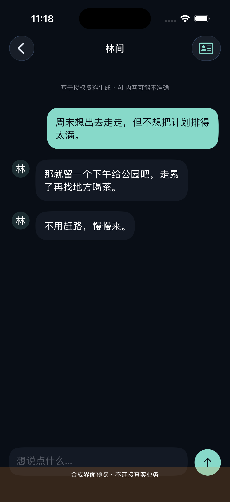

# Relic · AI 角色产品工程记录
Relic 基于用户授权的人物资料与素材生成 AI 角色。核心产品闭源，这个独立作品集展示产品决策、架构、工程案例和有范围的验证结果。

**2026-10-29：1.0.0 / build17 开发候选，尚未正式发布，尚未达到提交审核门槛。** 本轮完成主要页面重构和真实模型隔离业务验证；稳定生产托管、最新真机回归、完整跨端及机器人验收仍有缺口。不能将 App Store 记录建立或历史共享成功解释成当前服务可用。

用户流程：导入 TXT / CSV / JSON 或授权电脑上传 → 预览与说话人确认 → 人物资料确认 → MiniMax 生成画像 → 聊天与记忆。这里的“蒸馏”是画像和上下文提取，不是训练模型权重。AI 角色不是真实自然人本人。

## 实际运行界面
下图为 iOS Simulator 运行中的 Debug 合成资料预览，原始截图，**不是私人聊天、真实业务验收或商店截图**。这是较早 build17 视觉检查；底部预览横幅遮挡、详情副标题对比度和聊天标题已在代码修正，最终再次运行待完成。没有伪造改前图。

| 首页 | 角色详情 | 聊天 |
|---|---|---|
|  |  |  |

- [产品流程](docs/product.md) · [架构与数据归属](docs/architecture.md)
- [工程案例](docs/engineering-case-studies.md) · [验证结果](docs/validation.md)
- [当前进度](docs/progress.md) · [路线与限制](docs/roadmap.md)
- [开发者贡献](docs/ownership-and-attribution.md) · [简历摘要](docs/resume.md)

开发者主导需求、交互、身份与数据边界、整合和验收；使用 AI 编程助手辅助实施代码、测试、界面及文档。未提供访客业务演示服务，不公开核心源码、私有历史、用户素材或安装包，没有虚构用户量、收入或效果指标。

Relic is a closed-source AI character product in active development. These are scoped engineering results and synthetic UI captures, not a production availability claim.
