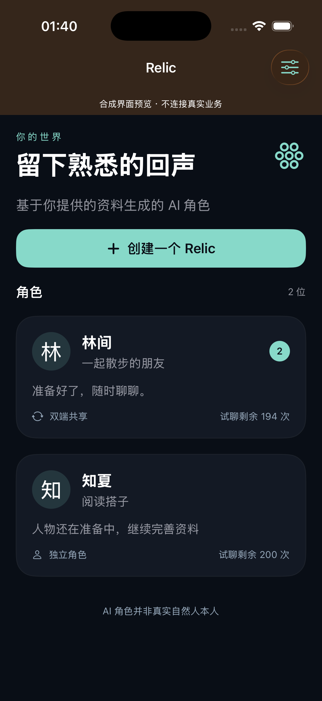
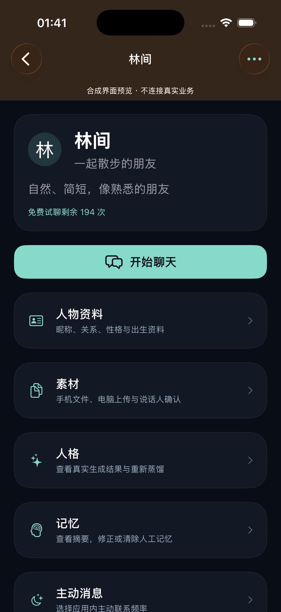
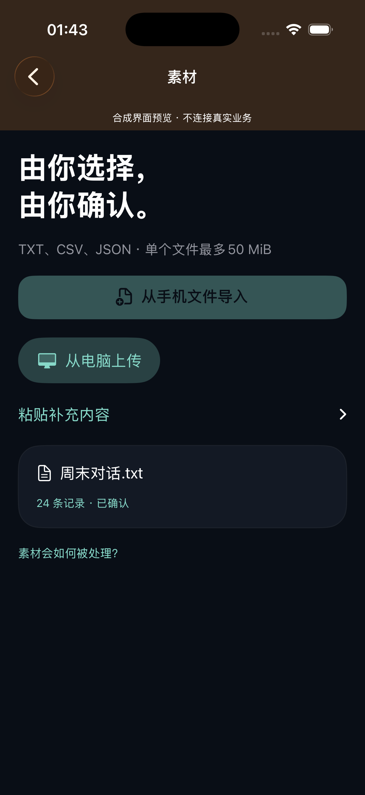

# Relic · AI 角色产品工程记录
Relic 基于用户授权的人物资料与素材生成 AI 角色。核心产品闭源，这个独立作品集展示产品决策、架构、工程案例和有范围的验证结果。

**2026-10-30：1.0.0 / 源码与模拟器构建 build20，iPhone 实际安装 build18。尚未达到完整测试分发或审核门槛。** 正常 Xcode 签名归档18与 Apple 官方 Validate App 已通过；没有构建上传、内部 TestFlight 或审核提交。稳定主机的隔离部署已推进到加密传输及安装任务，业务 HTTPS 仍未验通。

用户流程：导入 TXT / CSV / JSON 或授权电脑上传 → 预览与说话人确认 → 人物资料确认 → MiniMax 生成画像 → 聊天与记忆。这里的“蒸馏”是画像和上下文提取，不是训练模型权重。AI 角色不是真实自然人本人。

## 实际运行界面
下图为实际 iOS Simulator 运行的 Debug 合成资料原图，**不是私人聊天、真实业务验收或商店截图**。首页、详情、素材为 build19；build20 只取得新构建产物，最终全页复验待完成。

| 首页19 | 角色详情19 | 素材19 |
|---|---|---|
|  |  |  |

[真实改前详情18](assets/ui/before-detail-build18.png) → [修复后详情19](assets/ui/after-detail.png)：运行发现预览提示压住导航标题，调整后重新运行并核对。另有[资料输入键盘19](assets/ui/profile-keyboard-build19.png)与[较早聊天17](assets/ui/after-chat.png)，不混作最终版本验收。

- [产品流程](docs/product.md) · [架构与数据归属](docs/architecture.md)
- [工程案例](docs/engineering-case-studies.md) · [验证结果](docs/validation.md)
- [当前进度](docs/progress.md) · [路线与限制](docs/roadmap.md)
- [开发者贡献](docs/ownership-and-attribution.md) · [简历摘要](docs/resume.md)

开发者主导需求、交互、身份与数据边界、整合和验收；使用 AI 编程助手辅助实施代码、测试、界面及文档。未提供访客业务演示服务，不公开核心源码、私有历史、用户素材或安装包，没有虚构用户量、收入或效果指标。

Relic is a closed-source AI character product in active development. These are scoped engineering results and synthetic UI captures, not a production availability claim.
