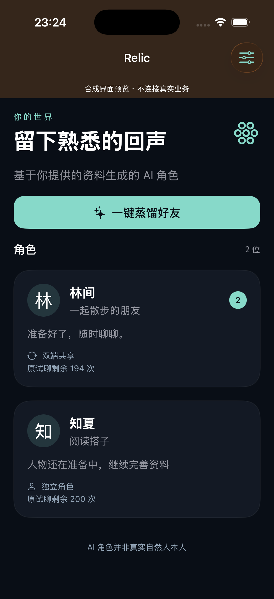
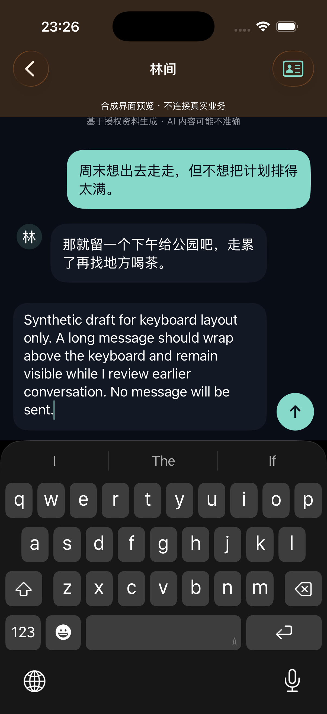

# Relic · AI 角色产品工程记录

Relic 基于用户授权的人物资料与素材生成 AI 角色。核心产品闭源；这个独立作品集展示产品决策、架构、真实工程案例及有范围的验证结果。

## 当前交付边界 · 2026-11-05

1.0.0 (26) 已设备归档、签名、上传并通过 Apple 二进制校验，加入原有内部 TestFlight 组。2026-11-05已通过TestFlight在原iPhone完成更新并启动，原账号与角色可读取；完整核心流程仍保留21基线，不扩大为26全流程通过。

既有 HTTPS 服务已完成有备份的兼容更新并回读生效配置，真实回复预览开关已启用；真实微信中转的受保护角色列表、详情读取通过。微信普通账号准入、第二真实账号隔离、新长素材流程、支付沙盒、机器人和多天主动联系仍未完成整体验收。

build26加入蒸馏请求的持久恢复和成功删除后的本机待处理记录清理。对应恢复、删除回执与机器人发送/撤销锁的最小兼容后端更新已部署，Linux隔离测试及真实微信受保护读取通过，原业务数据与配置保持一致。机器人和自动蒸馏等新流程仍关闭；真实微信收发与新版手机受影响业务流程仍待验。

## 实际运行界面

以下保留的是 **build25 Debug / iOS Simulator** 原图，使用合成角色、消息和演示额度，不是私人聊天、真实余额、Release 或 iPhone 业务验收。长草稿位于软件键盘上方；未发送该草稿。

| 首页 | 长草稿与键盘 |
|---|---|
|  |  |

build25另有登录、角色详情、人物资料、素材、人格、记忆、连接错误、设置和创建降级页面的实际检查记录。build26已重新运行并保存10张Debug合成截图，本仓库尚未新增这些图片。大字、VoiceOver、新版手机冲突与完整自动蒸馏流程没有据此宣称通过。旧版截图与改前证据保留各自构建标记。

## 真实模型对照

此前使用现有 MiniMax-M2.7 完成10组合成素材 A/B、每侧1次，总20次真实调用。9组取得完整回复，1组一侧格式解析失败；没有补造回复、写入用户对话或扣用户额度。辅助模型在不知左右答案的条件下评审：差异识别3/5、控制项4/4、不变量7/9；这不是人工或多人质量验收。

本次发现目标表达差异未落实、增加未经确认的安排两类问题，保留失败和限制。全响应延迟 P50 2.507秒（中位数）、P95 3.707秒（nearest-rank，n=20），不是流式首段延迟。没有真实账单金额，不能推导盈利。[测量与样本边界](docs/validation.md)

## 已保留的手机基线

TestFlight21 同一隔离合成角色：系统文件选择 TXT → 解析7条记录 → 双方及人物确认 → 真实蒸馏 → 手机聊天3气泡 → 记忆修改、清空 → 冷启动回读。额度200→199，多气泡算一次。微信小程序同机读取共享数据并反向保存记忆后，iOS重新进入页面可回读。新版前台刷新、草稿冲突和完整删除传播需独立复验。

## 产品与工程

导入 TXT / CSV / JSON 或授权电脑上传 → 内容与说话人确认 → 人物资料确认 → MiniMax生成画像 → 聊天与记忆。“蒸馏”指画像及上下文提取，不是训练模型权重。AI角色不是真实自然人本人。

- [产品流程](docs/product.md) · [架构与数据归属](docs/architecture.md)
- [工程案例](docs/engineering-case-studies.md) · [验证结果](docs/validation.md)
- [当前进度](docs/progress.md) · [路线与限制](docs/roadmap.md)
- [开发者贡献](docs/ownership-and-attribution.md) · [简历摘要](docs/resume.md)

开发者主导需求、交互、身份与数据边界、整合和验收；使用AI编程助手辅助代码、测试、界面及文档。未公开核心源码、私有历史、用户素材或安装包；没有虚构用户量、收入和效果指标。未提交审核或正式发布。

Relic is a closed-source product in active development. Scoped engineering results and synthetic UI captures do not establish production readiness.
