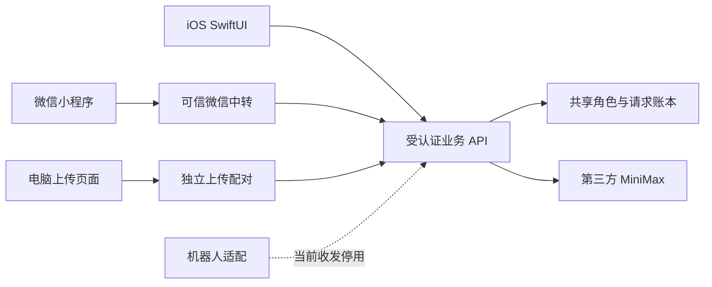

# 高层架构

iOS使用服务端验证的Apple身份；微信使用平台可信身份。双方确认的账号绑定建立映射，不能用昵称、手机号或客户端自报ID合并。电脑上传授权、机器人连接和账号绑定是三种不同凭证。

新共享角色的资料、素材、消息、记忆、读水位、额度和删除状态以统一后端为准。客户端保留显示缓存；更新使用修订检查避免覆盖。旧两端数据仍各自保留，不做自动迁移。

Python后端提供业务、认证、上传、模型调用与删除；微信云函数保留平台侧业务及共享中转。当前测试入口存在运行恢复限制，不是稳定生产托管。客户端不能无限后台；主动消息需要平台支持的服务端运行方式，当前隔离环境不对全体账号运行任务。

“蒸馏”是人物画像与上下文提取流程，不训练基础模型。核心提示词、记忆策略与部署细节未公开。
